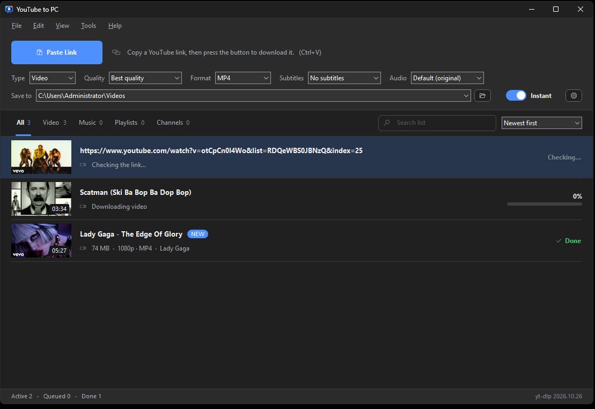
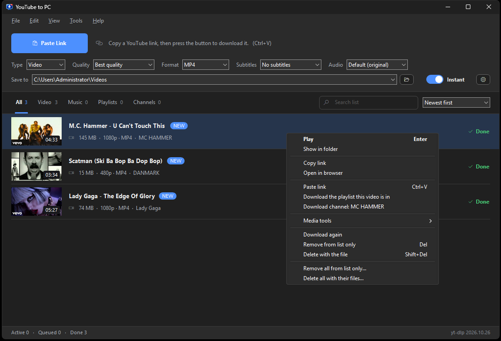
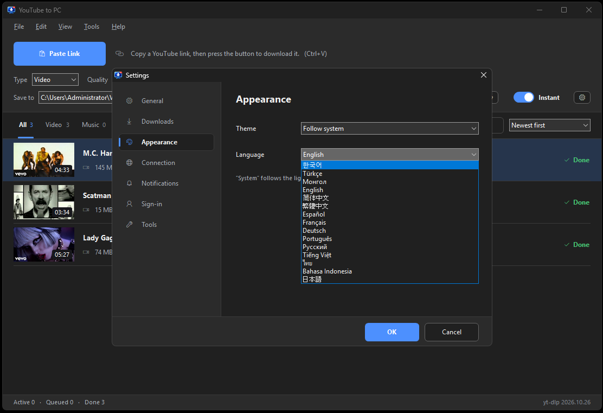

<div align="center">


# YouTube to PC

[한국어](README.ko.md) ·
[Türkçe](README.tr.md) ·
[Монгол](README.mn.md) ·
[English](../README.md) ·
[简体中文](README.zh-Hans.md) ·
[繁體中文](README.zh-Hant.md) ·
[Español](README.es.md) ·
**Français** ·
[Deutsch](README.de.md) ·
[Português](README.pt.md) ·
[Русский](README.ru.md) ·
[Tiếng Việt](README.vi.md) ·
[ไทย](README.th.md) ·
[Bahasa Indonesia](README.id.md) ·
[日本語](README.ja.md)

**La façon la plus simple d'enregistrer les vidéos et musiques YouTube sur votre PC**

Copiez un lien, appuyez sur un bouton. C'est tout.

<br>

### [⬇️ Télécharger YouTubeToPC-Setup-1.3.2.exe](https://github.com/bruce-jsh/YouTube-to-PC/releases/download/v1.3.2/YouTubeToPC-Setup-1.3.2.exe)

1,3 Mo · Windows 10/11 (64 bits) · cliquez sur le bouton, le fichier se télécharge aussitôt

Bloqué par Windows ou votre navigateur ? [Voici comment faire](troubleshooting.fr.md).



*Collez un lien et le téléchargement démarre.*



*Retirer de la liste et supprimer le fichier sont deux choix distincts.*



*Quinze langues, au choix dans les paramètres.*
</div>

---

## Vous pouvez l'utiliser en toute tranquillité

**Rien d'autre à installer.**
Pas besoin de .NET Framework, des redistribuables Visual C++, de Python ou quoi que ce soit.
C'est un programme Win32 qui n'utilise que ce que Windows contient déjà. Téléchargez et lancez.

**Aucune publicité.**
Pas de bannières, pas de fenêtres surgissantes, pas de « passez à la version supérieure ».
Il n'y a pas non plus de version payante.

**Aucune donnée personnelle collectée.**
Pas d'inscription, pas de connexion. Rien sur votre utilisation n'est envoyé où que ce soit.
Vos réglages et votre liste de téléchargements restent sur votre propre PC.

**Aucun logiciel ajouté.**
L'installation ne glisse pas d'autres programmes et ne touche pas aux réglages de votre navigateur.

---

## Ce qu'il fait

- Appuyez sur **Coller le lien** et le téléchargement démarre (`Ctrl+V` fonctionne aussi)
- Choisissez **vidéo** (MP4, MKV) ou **musique** (MP3, M4A)
- Qualité de **la meilleure disponible** jusqu'à 144p ; audio du meilleur jusqu'à 128 kbit/s
- Récupérez **une playlist ou une chaîne entière**, ou cochez seulement ce que vous voulez
- Choisissez **sous-titres et pistes audio** : environ 85 langues, chacune dans sa propre écriture
- De 1 à 8 téléchargements simultanés
- **Thème clair et sombre**, ou selon le réglage de Windows
- Disponible en **15 langues**
- Miniatures, progression et temps restant
- Lire le fichier ou ouvrir son dossier
- Extraire l'audio d'une vidéo enregistrée
- Conserve un historique

---

## Installation

1. Cliquez sur le bouton de téléchargement ci-dessus. L'installateur est enregistré immédiatement.
2. Lancez-le.
3. Choisissez la langue et le dossier d'installation, puis appuyez sur **Installer**.

L'installation nécessite une connexion internet : elle télécharge les outils utilisés
par l'application (yt-dlp et FFmpeg) et **en garde ses propres copies dans le dossier
du programme**. Cela prend en général 10 à 30 secondes.

> **Si Windows affiche « Windows a protégé votre ordinateur »**
> Cliquez sur **Informations complémentaires → Exécuter quand même**.
> Cet avertissement apparaît parce que le programme est l'œuvre d'une seule personne
> et n'a pas de certificat de signature payant. Ce n'est pas un virus.

Pour le supprimer, utilisez **Paramètres → Applications**, ou lancez `Uninstall.exe`
dans le dossier d'installation. Vos vidéos et musiques téléchargées ne sont jamais effacées.

---

## Utilisation

1. Copiez l'adresse d'une vidéo sur YouTube.
2. Appuyez sur **Coller le lien** dans l'application.
3. Voilà. Elle apparaît dans la liste et le téléchargement commence.

Pour choisir la qualité ou les sous-titres de chaque vidéo, désactivez **Immédiat**.
Une fenêtre d'options s'ouvrira alors à chaque lien ajouté.

Collez l'adresse d'une playlist ou d'une chaîne et vous obtenez la liste complète
des vidéos, avec des cases pour ne cocher que celles qui vous intéressent.

---

## Questions

**Les téléchargements ne marchent plus d'un coup.**
Quand YouTube change, l'outil de téléchargement doit changer aussi.
L'application vérifie une fois par jour, mais vous pouvez lancer
**Outils → Mettre à jour yt-dlp** vous-même.

**Ça ne marche pas sur le réseau de mon entreprise.**
Essayez de saisir une adresse de proxy dans **Paramètres → Connexion**.

**Les vidéos avec limite d'âge échouent.**
Dans **Paramètres → Connexion au compte**, choisissez un navigateur où vous êtes connecté à YouTube.

---

## Compiler soi-même

```
build.bat
```

Sous Windows, il suffit du g++ UCRT64 de [MSYS2](https://www.msys2.org).
Ni Visual Studio, ni .NET SDK.

---

## Outils utilisés

| Nom | Rôle | Licence |
|---|---|---|
| [yt-dlp](https://github.com/yt-dlp/yt-dlp) | Télécharger depuis YouTube | Unlicense |
| [FFmpeg](https://ffmpeg.org) | Fusionner vidéo et audio, convertir | GPLv3 |
| [QuickJS-ng](https://github.com/quickjs-ng/quickjs) | Exécuter les vérifications JavaScript de YouTube | MIT |

L'installation télécharge la version officielle de chaque projet.
Les mentions complètes se trouvent dans [THIRD-PARTY-NOTICES](../licenses/THIRD-PARTY-NOTICES.txt).

---

## À noter

Ne téléchargez que du contenu que vous avez le droit d'enregistrer.
Cet outil est destiné au contenu qui vous appartient, pour lequel vous avez
l'autorisation, ou qui est libre de droits. L'usage que vous en faites relève de
votre responsabilité.

---

## Licence

[MIT](../LICENSE). Le code source est à lire, modifier et réutiliser librement.

---

## Politique de signature de code (Code signing policy)

Free code signing provided by [SignPath.io](https://about.signpath.io), certificate by [SignPath Foundation](https://signpath.org).

| Rôle | Qui |
|---|---|
| Commits et relecture | [Bruce Jung](https://github.com/bruce-jsh) |
| Approbation des signatures | [Bruce Jung](https://github.com/bruce-jsh) |

**Politique de confidentialité.** Ce programme ne transfère aucune information vers d'autres systèmes en réseau sans demande expresse de la personne qui l'utilise ou l'installe.

Il contacte YouTube pour les vidéos demandées, i.ytimg.com pour les vignettes de la liste et GitHub pour chercher de nouvelles versions de yt-dlp et de ce programme. Ces vérifications se désactivent dans les paramètres. Pas de compte, pas de connexion, aucun suivi d'usage.

---

<div align="center">

J'ai quitté mon emploi il y a quelques jours. Je m'ennuyais chez moi, alors j'ai fait ça.<br>
Je rêve d'être freelance, depuis une petite chambre à Mukdong, Séoul en Corée.
31 octobre 2026.

**Bruce Jung** · [sunghunet@gmail.com](mailto:sunghunet@gmail.com)

</div>
