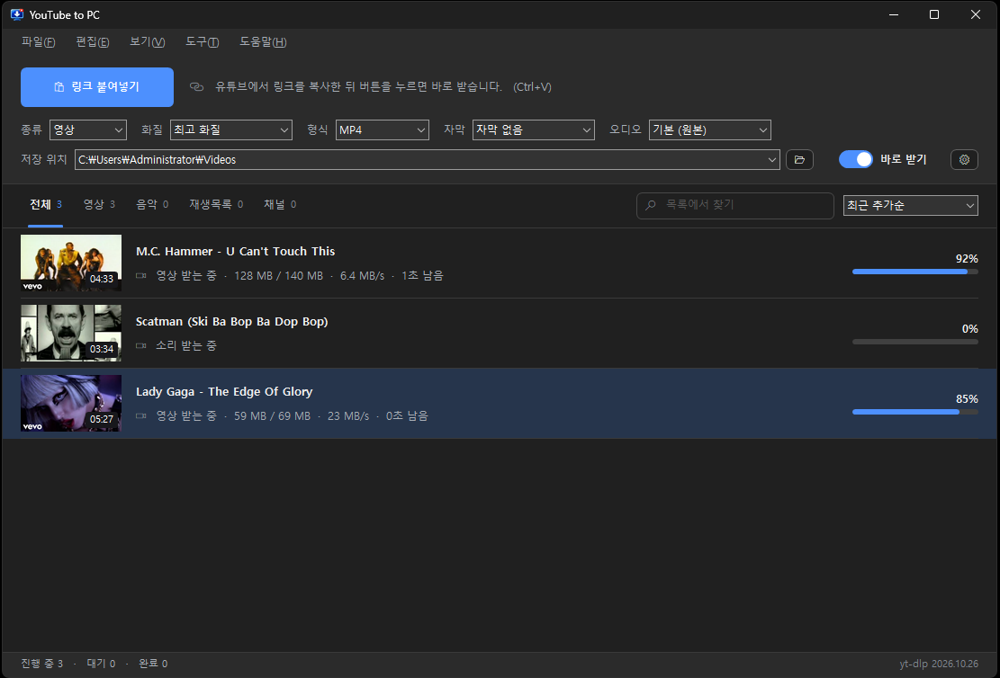
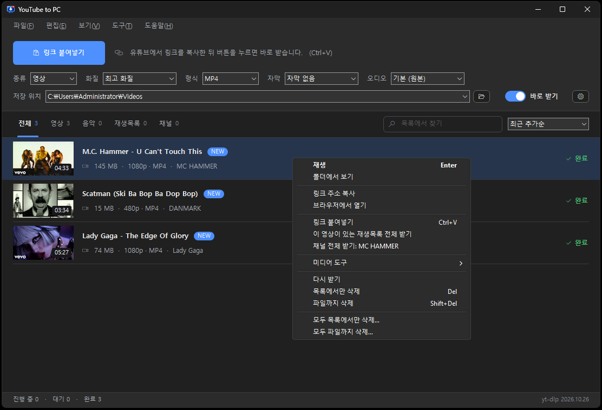

<div align="center">


# YouTube to PC

**유튜브 영상과 음악을 내 PC에 저장하는 가장 간단한 방법**

링크를 복사하고 버튼 한 번. 그게 전부입니다.

<br>

### [⬇️ YouTubeToPC-Setup-1.3.1.exe 내려받기](https://github.com/bruce-jsh/YouTube-to-PC/releases/download/v1.3.1/YouTubeToPC-Setup-1.3.1.exe)

1.3 MB · Windows 10/11 (64비트) · 버튼을 누르면 바로 내려받습니다

Windows나 브라우저가 막나요? [해결 방법을 정리해 두었습니다](troubleshooting.ko.md).



*링크를 붙여넣으면 바로 받기 시작합니다.*



*목록에서만 지우기와 파일까지 지우기를 따로 고릅니다.*


*15개 언어, 설정에서 고릅니다.*

<br>

**한국어** ·
[Türkçe](README.tr.md) ·
[Монгол](README.mn.md) ·
[English](../README.md) ·
[简体中文](README.zh-Hans.md) ·
[繁體中文](README.zh-Hant.md) ·
[Español](README.es.md) ·
[Français](README.fr.md) ·
[Deutsch](README.de.md) ·
[Português](README.pt.md) ·
[Русский](README.ru.md) ·
[Tiếng Việt](README.vi.md) ·
[ไทย](README.th.md) ·
[Bahasa Indonesia](README.id.md) ·
[日本語](README.ja.md)


</div>

---

## 안심하고 쓰셔도 됩니다

**별도 설치가 전혀 필요 없습니다.**
.NET Framework, Visual C++ 재배포 패키지, 파이썬 같은 것을 따로 깔지 않아도 됩니다.
Windows에 원래 들어 있는 기능만 사용하는 Win32 프로그램이라, 받아서 바로 실행하면 됩니다.

**광고가 하나도 없습니다.**
배너도, 팝업도, "지금 업그레이드하세요" 같은 창도 없습니다. 유료 버전도 없습니다.

**개인정보를 수집하지 않습니다.**
회원 가입도, 로그인도 없습니다. 사용 기록을 어디에도 보내지 않습니다.
설정과 다운로드 목록은 내 PC 안에만 저장됩니다.

**번들 프로그램이 따라오지 않습니다.**
설치할 때 다른 프로그램을 슬쩍 끼워 넣지 않습니다. 브라우저 설정도 건드리지 않습니다.

---

## 주요 기능

- **링크 붙여넣기** 버튼 하나로 바로 다운로드 (`Ctrl+V`도 됩니다)
- **영상**(MP4·MKV) 또는 **음악**(MP3·M4A) 선택
- 화질은 **최고 화질**부터 144p까지, 음질은 최고부터 128 kbps까지
- **재생목록·채널 통째로** 받기, 받을 영상만 골라서 받기
- **자막·오디오 트랙** 선택 (약 85개 언어, 각 언어의 원어 이름으로 표시)
- 동시 다운로드 1~8개
- **밝은 테마·어두운 테마**, 시스템 설정 따라가기
- **15개 언어** 지원
- 썸네일·진행률·남은 시간 표시
- 완료된 파일 바로 재생·폴더 열기
- 받은 영상에서 음원만 추출
- 다운로드 기록 보관

---

## 설치 방법

1. 위의 다운로드 버튼을 누릅니다. 설치 파일이 바로 저장됩니다.
2. 파일을 실행합니다.
3. 언어와 설치 위치를 고르고 **설치**를 누릅니다.

설치할 때 인터넷 연결이 필요합니다. 프로그램이 사용하는 도구(yt-dlp, FFmpeg)를
내려받아 **프로그램 폴더 안에 따로 보관**하기 때문입니다. 보통 10~30초면 끝납니다.

> **"Windows의 PC 보호" 창이 뜨면**
> **추가 정보 → 실행**을 눌러 주세요.
> 개인이 만든 프로그램이라 유료 코드 서명 인증서가 없어서 나타나는 안내입니다.
> 바이러스가 아닙니다.

제거는 **설정 → 앱**에서 하시거나, 설치 폴더의 `Uninstall.exe`를 실행하시면 됩니다.
받아 둔 영상과 음악 파일은 지워지지 않습니다.

---

## 사용 방법

1. 유튜브에서 영상 주소를 복사합니다.
2. 프로그램의 **링크 붙여넣기** 버튼을 누릅니다.
3. 끝입니다. 목록에 나타나고 바로 받기 시작합니다.

화질이나 자막을 영상마다 고르고 싶으시면 **바로 받기**를 꺼 주세요.
링크를 넣을 때마다 선택 창이 열립니다.

재생목록이나 채널 주소를 넣으면 전체 영상 목록이 나오고, 받을 것만 체크할 수 있습니다.

---

## 자주 묻는 질문

**다운로드가 갑자기 안 됩니다.**
유튜브가 바뀌면 다운로드 도구도 따라서 바뀌어야 합니다.
프로그램이 하루에 한 번 자동으로 최신 버전을 확인하지만,
급할 때는 **도구 → yt-dlp 업데이트**를 직접 눌러 주세요.

**회사 네트워크에서 안 됩니다.**
**설정 → 연결**에서 프록시 주소를 넣어 보세요.

**연령 제한 영상이 안 받아집니다.**
**설정 → 로그인**에서 유튜브에 로그인한 브라우저를 고르시면 됩니다.

---

## 직접 빌드하기

```
build.bat
```

Windows에서 [MSYS2](https://www.msys2.org)의 UCRT64 g++만 있으면 빌드됩니다.
Visual Studio나 .NET SDK는 필요 없습니다.

---

## 함께 쓰는 프로그램

| 이름 | 역할 | 라이선스 |
|---|---|---|
| [yt-dlp](https://github.com/yt-dlp/yt-dlp) | 유튜브 다운로드 | Unlicense |
| [FFmpeg](https://ffmpeg.org) | 영상·소리 합치기, 음원 변환 | GPLv3 |
| [QuickJS-ng](https://github.com/quickjs-ng/quickjs) | 유튜브의 자바스크립트 처리 | MIT |

설치할 때 각 프로젝트의 공식 배포본을 내려받습니다.
자세한 고지는 [THIRD-PARTY-NOTICES](../licenses/THIRD-PARTY-NOTICES.txt)에 있습니다.

---

## 알아두실 점

저작권이 있는 콘텐츠는 **권리자의 허락을 받은 경우에만** 내려받으세요.
이 프로그램은 개인이 허락받은 콘텐츠나 저작권이 없는 콘텐츠를 위한 도구입니다.
사용에 따른 책임은 사용자에게 있습니다.

---

## 라이선스

[MIT](../LICENSE). 소스 코드를 읽고 고치고 다시 쓰셔도 됩니다.

---

## 코드 서명 정책 (Code signing policy)

Free code signing provided by [SignPath.io](https://about.signpath.io), certificate by [SignPath Foundation](https://signpath.org).

| 역할 | 담당 |
|---|---|
| 커밋 · 검토 | [Bruce Jung](https://github.com/bruce-jsh) |
| 서명 승인 | [Bruce Jung](https://github.com/bruce-jsh) |

**개인정보 처리방침.** 이 프로그램은 사용자가 직접 요청하지 않는 한 어떤 정보도 외부로 보내지 않습니다.

요청하신 영상을 받기 위해 YouTube에, 목록 썸네일을 위해 i.ytimg.com에, yt-dlp와 이 프로그램의 새 버전을 확인하기 위해 GitHub에 접속합니다. 버전 확인은 설정에서 끌 수 있습니다. 계정도 로그인도 없고 사용 기록을 수집하지 않습니다.

---

<div align="center">

며칠 전에 회사를 그만뒀습니다. 집에서 뒹굴다 심심해서 이걸 만들었습니다.<br>
꿈은 프리랜서. 작업실은 대한민국 서울 중랑구 묵동의 방 한 칸입니다.
2026년 10월 31일.

**Bruce Jung** · [sunghunet@gmail.com](mailto:sunghunet@gmail.com)

</div>
