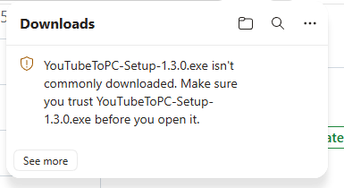
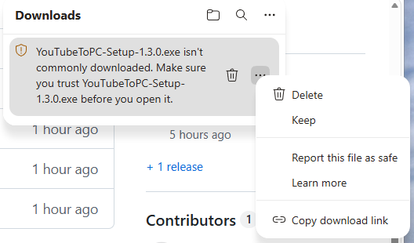
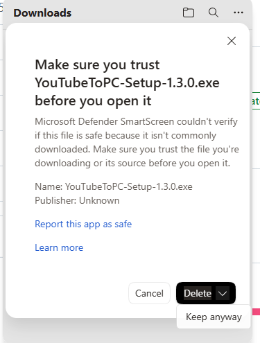

<div align="center">


# Si Windows no te deja descargar o instalar

</div>

---

**Ninguno de estos avisos significa que el programa sea peligroso.**

Windows confía en el software por su reputación, y esa reputación se compra con un
certificado de firma. Este programa lo escribe una sola persona y todavía no tiene
uno, así que Windows lo trata como a un desconocido y lo dice en voz alta.

Busca tu aviso abajo. Casi todos se resuelven en tres clics.

---

## Lo más rápido: usa otro navegador

El estricto es Microsoft Edge. **Chrome y Firefox descargan este archivo sin decir
nada.**

Si Edge te está dando problemas, abre la
[página de descarga](https://github.com/bruce-jsh/YouTube-to-PC/releases/latest)
en Chrome o Firefox y pulsa el botón allí. Eso es todo.

Si prefieres seguir en Edge, continúa leyendo.

---

## 1. Edge bloquea la descarga

Aparece un aviso que dice que el archivo **no se descarga habitualmente**.



**Paso 1.** Pulsa `Ctrl` + `J` para abrir **Descargas** y pulsa el botón **…** de
esa fila.



**Paso 2.** Elige **Conservar** (Keep).

**Paso 3.** Se abre una segunda ventana. Aquí es donde la gente se atasca: el único
botón visible dice **Eliminar** (Delete). Pulsa la **flechita que hay junto a
Eliminar** y elige **Conservar de todos modos** (Keep anyway).



La descarga termina con normalidad.

> Ya que estás en ese menú, merece la pena pulsar **Notificar que el archivo es
> seguro** (Report this file as safe). Cuantas más personas lo hagan, antes dejará
> de aparecer este aviso para todo el mundo.

---

## 2. "Windows protegió su PC" al ejecutarlo

Puede aparecer una ventana azul que dice que Windows protegió tu PC y que solo
ofrece el botón **No ejecutar**.

1. Pulsa el pequeño enlace **Más información** que hay bajo el mensaje. Es texto
   normal, no un botón, y se pasa por alto con facilidad
2. Abajo aparece un botón nuevo: **Ejecutar de todas formas**
3. Púlsalo

Esta ventana suele salir la primera vez que ejecutas el archivo en un PC. Una vez
que lo permites, Windows no vuelve a preguntar en ese equipo.

---

## 3. El antivirus borró el archivo

La descarga termina y el archivo ha desaparecido.

1. Abre **Seguridad de Windows** desde el menú Inicio
2. Ve a **Protección antivirus y contra amenazas**
3. En **Historial de protección** busca la entrada `YouTubeToPC-Setup`
4. Ábrela, pulsa **Acciones** y elige **Permitir en el dispositivo**
5. Descarga el archivo otra vez

Con otros antivirus (Avast, AVG, Norton, McAfee) añade una excepción para el
instalador o para la carpeta donde se instala:

```
C:\Program Files\YouTube to PC
```

O pausa la protección en tiempo real un minuto, instala y vuelve a activarla.

---

## 4. La instalación empieza y se detiene

Los mensajes sobre yt-dlp o sobre comprobar la conexión significan que el
instalador no pudo descargar las herramientas que necesita.

El instalador ocupa apenas 1 MB. Durante la instalación descarga yt-dlp, FFmpeg y
QuickJS de sus páginas oficiales, unos 110 MB en total, y guarda sus propias copias
dentro de la carpeta del programa.

Prueba en este orden.

**a. Apaga la VPN y vuelve a ejecutar el instalador.** Es la causa más frecuente.

**b. Permítelo en el firewall.** **Seguridad de Windows** →
**Firewall y protección de red** → **Permitir una aplicación a través del firewall**
→ **Cambiar configuración** → **Permitir otra aplicación** → **Examinar**, elige el
instalador, **Agregar**, y marca tanto **Privada** como **Pública**.

**c. Prueba otra red.** Las redes de empresa, de centros educativos y algunas
públicas bloquean GitHub, que es de donde vienen las herramientas. Una conexión
doméstica o compartir datos del móvil suele funcionar.

---

## 5. No pasa absolutamente nada

- **Hago doble clic y no ocurre nada.** Haz clic derecho en el archivo y elige
  **Ejecutar como administrador**.
- **"Esta aplicación no se puede ejecutar en el equipo".** Necesitas Windows 10 u
  11 de 64 bits. Compruébalo en **Configuración**, **Sistema**, **Acerca de**.
- **El archivo ocupa 0 bytes o no abre.** La descarga se cortó. Bórralo y descarga
  de nuevo.

---

## Comprobar que el archivo es auténtico

Cada página de versión indica el SHA-256 del instalador. Abre PowerShell en la
carpeta donde está el archivo y ejecuta:

```powershell
Get-FileHash .\YouTubeToPC-Setup-1.3.1.exe -Algorithm SHA256
```

Si coincide con el valor de la
[página de la versión](https://github.com/bruce-jsh/YouTube-to-PC/releases/latest),
tienes exactamente el archivo publicado y nadie lo ha tocado.

---

## Por qué ocurre esto

Un certificado de firma cuesta dinero cada año y, sin él, Windows no tiene forma de
saber quién escribió este programa.

A cambio, el código es abierto, cada versión se compila en público con
[GitHub Actions](https://github.com/bruce-jsh/YouTube-to-PC/actions) y el hash de
arriba te permite confirmar que recibiste esa compilación exacta.

Ya hay trabajo en marcha para conseguir la firma. Cuando esté, estos avisos
desaparecerán.

---

## Si sigues atascado

Escribe a **[sunghunet@gmail.com](mailto:sunghunet@gmail.com)** o abre una
[incidencia](https://github.com/bruce-jsh/YouTube-to-PC/issues). Cuéntame qué decía
el mensaje y en qué paso apareció. Una captura ayuda mucho.

<div align="center">

[Volver a la página principal](README.es.md)

</div>
