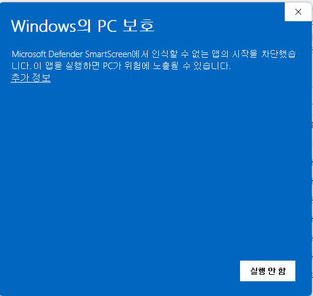
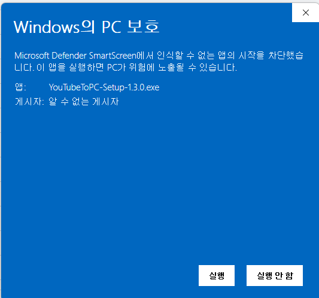

<div align="center">


# 다운로드나 설치가 막힐 때

</div>

---

**여기 나오는 경고는 모두 위험하다는 뜻이 아닙니다.**

Windows는 프로그램을 평판으로 신뢰합니다. 그 평판은 서명 인증서를 사서 얻습니다.
이 프로그램은 한 사람이 만들었고 아직 인증서가 없어서, Windows가 처음 보는
프로그램으로 취급하며 크게 경고합니다.

겪고 계신 화면을 아래에서 찾으세요. 대부분 세 번만 누르면 끝납니다.

---

## 가장 빠른 방법: 다른 브라우저로 받기

까다로운 쪽은 Microsoft Edge입니다. **Chrome과 Firefox는 아무 말 없이 받아집니다.**

Edge에서 막히신다면
[다운로드 페이지](https://github.com/bruce-jsh/YouTube-to-PC/releases/latest)를
Chrome이나 Firefox로 열고 버튼을 누르세요. 그걸로 끝입니다.

Edge를 계속 쓰고 싶으시면 아래를 보세요.

---

## 1. Edge가 다운로드를 막을 때

**일반적으로 다운로드되지 않는 파일**이라는 안내가 나타납니다.


**1단계.** `Ctrl` + `J`를 눌러 **다운로드** 목록을 열고, 그 줄의 **…** 버튼을
누릅니다.


**2단계.** **유지**(Keep)를 선택합니다.

**3단계.** 두 번째 창이 나타납니다. 여기서 많이들 막힙니다. 눈에 보이는 버튼은
**삭제**(Delete)뿐입니다. **삭제 버튼 옆의 작은 화살표**를 누르면
**계속 유지**(Keep anyway)가 나옵니다.


그러면 다운로드가 정상적으로 끝납니다.

> 그 메뉴에 있는 **안전한 파일로 보고**(Report this file as safe)도 눌러주시면
> 좋습니다. 보고가 쌓일수록 다음 분들은 이 경고를 덜 보게 됩니다.

---

## 2. 실행할 때 "Windows의 PC 보호"가 뜰 때

파란 창이 나타나고 **실행 안 함** 버튼만 보입니다.



**1단계.** 문구 아래의 작은 **추가 정보** 링크를 누릅니다. 버튼이 아니라 그냥
글씨라서 놓치기 쉽습니다.

**2단계.** 아래쪽에 **실행** 버튼이 새로 생깁니다. 그것을 누르세요.



이 창은 보통 그 PC에서 처음 실행할 때 한 번 뜹니다. 한 번 허용하고 나면 같은 PC에서는
다시 묻지 않습니다.

---

## 3. 백신이 파일을 지웠을 때

다운로드가 끝났는데 파일이 사라져 있습니다.

1. 시작 메뉴에서 **Windows 보안**을 엽니다
2. **바이러스 및 위협 방지**로 들어갑니다
3. **보호 기록**에서 `YouTubeToPC-Setup` 항목을 찾습니다
4. 항목을 펼치고 **작업**을 누른 뒤 **장치에서 허용**을 선택합니다
5. 파일을 다시 받습니다

V3, 알약, Avast, AVG, Norton 같은 다른 백신을 쓰신다면 설치 파일이나 설치 폴더를
예외로 등록하세요.

```
C:\Program Files\YouTube to PC
```

또는 실시간 감시를 잠시 끄고 설치한 뒤 다시 켜셔도 됩니다.

---

## 4. 설치가 중간에 멈출 때

yt-dlp를 받지 못했다거나 인터넷 연결을 확인하라는 메시지가 나오면, 설치 프로그램이
필요한 도구를 내려받지 못한 것입니다.

설치 파일은 1 MB 남짓입니다. 설치하는 동안 yt-dlp, FFmpeg, QuickJS를 각 공식
페이지에서 약 110 MB 받아 프로그램 폴더 안에 따로 보관합니다.

순서대로 시도해 보세요.

**가. VPN을 끄고 다시 설치해 보세요.** 가장 흔한 원인입니다.

**나. 방화벽에서 설치 프로그램을 허용하세요.** **Windows 보안** →
**방화벽 및 네트워크 보호** → **방화벽을 통해 앱 허용** → **설정 변경** →
**다른 앱 허용** → **찾아보기**에서 설치 파일을 고르고 **추가** → **개인**과
**공용** 모두 체크.

**다. 다른 네트워크로 해보세요.** 회사, 학교, 일부 공용 네트워크는 도구를 받아오는
GitHub를 막습니다. 집 인터넷이나 휴대폰 핫스팟이면 대개 됩니다.

---

## 5. 아무 반응이 없을 때

- **두 번 눌러도 아무 일이 없습니다.** 오른쪽 버튼을 눌러
  **관리자 권한으로 실행**을 선택하세요.
- **"이 앱은 PC에서 실행할 수 없습니다"**. 64비트 Windows 10 또는 11이 필요합니다.
  **설정 → 시스템 → 정보**에서 확인하세요.
- **파일 크기가 0이거나 열리지 않습니다.** 받다가 끊긴 것입니다. 지우고 다시
  받으세요.

---

## 받은 파일이 진짜인지 확인하기

릴리스 페이지에는 설치 파일의 SHA-256 값이 적혀 있습니다. 파일이 있는 폴더에서
PowerShell을 열고 아래를 실행하세요.

```powershell
Get-FileHash .\YouTubeToPC-Setup-1.3.2.exe -Algorithm SHA256
```

[릴리스 페이지](https://github.com/bruce-jsh/YouTube-to-PC/releases/latest)의
값과 같다면, 공개된 그 파일 그대로이며 누구도 손대지 않았다는 뜻입니다.

---

## 왜 이런 일이 생기나요

서명 인증서는 해마다 비용이 듭니다. 인증서가 없으면 Windows는 이 프로그램을 누가
만들었는지 알 방법이 없습니다.

대신 소스 코드는 공개되어 있고, 모든 배포본은
[GitHub Actions](https://github.com/bruce-jsh/YouTube-to-PC/actions)가 공개된
자리에서 빌드하며, 위의 해시로 그 빌드가 맞는지 직접 확인하실 수 있습니다.

서명을 받기 위한 작업을 진행하고 있습니다. 끝나면 이 경고들은 사라집니다.

---

## 그래도 안 되면

**[sunghunet@gmail.com](mailto:sunghunet@gmail.com)** 으로 메일을 주시거나
[이슈](https://github.com/bruce-jsh/YouTube-to-PC/issues)를 남겨주세요. 어떤
메시지가 어느 단계에서 나왔는지 알려주시면 됩니다. 화면 사진이 있으면 큰 도움이
됩니다.

<div align="center">

[메인 페이지로 돌아가기](README.ko.md)

</div>
